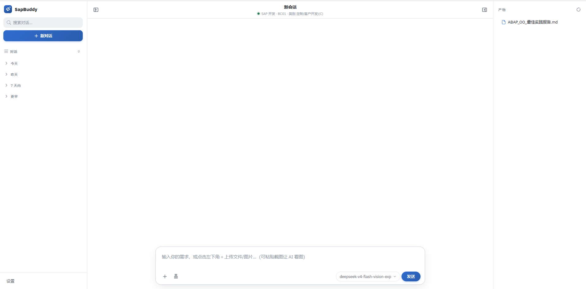
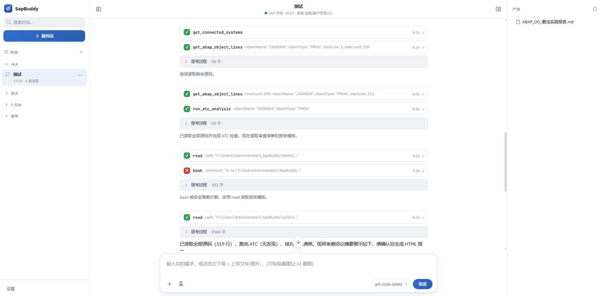
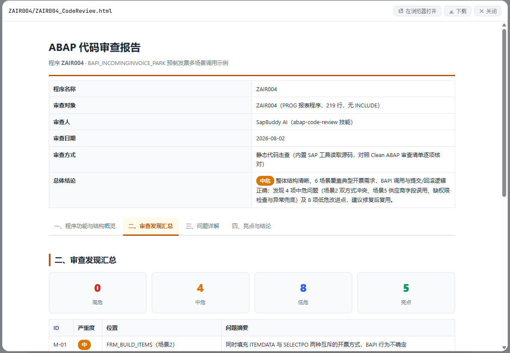
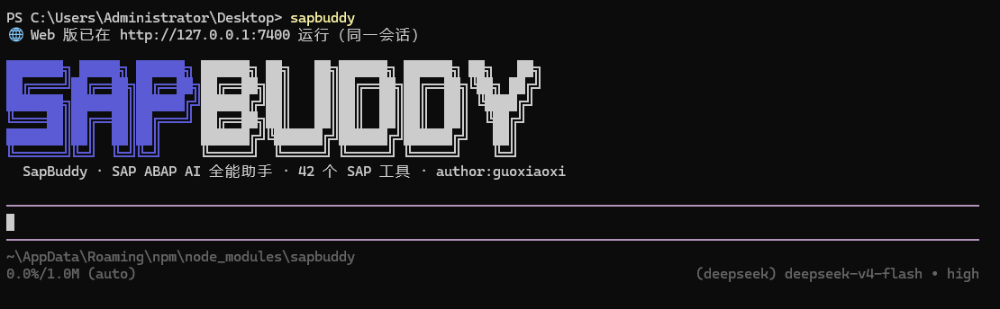

<p align="right"><strong><a href="./README.en.md">English</a></strong> | 简体中文</p>

<div align="center">

# 🛠 SapBuddy

**SAP ABAP AI 全能助手** —— 面向开发顾问与业务顾问

用自然语言驱动 **41 个 SAP 工具**：搜索、读码、开发、审查、ATC、单测、SQL、DDIC 管理、程序解读……

[](https://www.npmjs.com/package/sapbuddy)
[](LICENSE)
[](https://github.com/gxx950224/sapbuddy/actions)
[](package.json)
[](CONTRIBUTING.md)

</div>

---

## ✨ 为什么用 SapBuddy？

| 场景 | 传统方式 | SapBuddy |
|---|---|---|
| 查一个 Z 报表逻辑 | SE38 打开 → 逐行读 → 查表查字段 | 💬 "解释 ZPPR006 在做什么" |
| 开发新报表 | 手写选择屏幕/ALV/查询模板 | 💬 "创建报表 ZAIR007，读取 XXX" |
| 代码审查 | 人工逐条核对规范 | 💬 "审查 ZPPR085" → 4 页签 HTML 报告 |
| 查表数据 | SE16N 手动查询 | 💬 "查 T000 全部客户端类别" |
| DDIC 变更 | SE11 一步步建域/元素/表 | 💬 "创建数据元素+域"（自动补文本） |

## 🎯 核心特性

- 💬 **自然语言开发**：对话完成 SAP 对象查询、分析、开发、审查、测试
- 🛠 **41 个内置 SAP 工具**：对象搜索 / 源码读取 / where-used / ATC 质量门禁 / 单元测试 / SQL 查询 / 传输请求 / 版本历史 / ST22 dump 分析 / DDIC 管理（表/结构/数据元素/域/CDS）/ 文本元素与多语言翻译
- 🔒 **安全三重防线**：默认只读 + **开发客户端守卫**（`T000.CCCATEGORY` 非开发类自动拦截写操作）+ 生产环境 fail-closed
- 🖥 **CLI + Web 双模式**：终端交互 / 浏览器界面（SSE 流式）
- 🔀 **多模型**：DeepSeek / OpenAI / Anthropic / Qwen 等（pi 生态）
- 🔌 **MCP 兼容**：可接入外部 MCP 服务器（如 SAP 端 ZSX_MCP），CLI 与 Web 双端自动注册，工具即时可用

## 📸 截图

**Web 对话主界面** —— 浏览器里的对话页面，支持流式输出，随时查看 SAP 连接与模型状态



**一次真实对话的成果** —— 用一句大白话让 AI 读取并分析 SAP 对象，直接给出结果



**代码审查报告** —— 审查程序自动生成 4 页签 HTML 报告（质量评分 / 规范问题 / ATC）



**CLI 终端** —— 命令行全屏交互模式，终端里直接对话



## 🚀 快速开始

### 方式 A：npm 全局安装（推荐）

```bash
npm install -g sapbuddy
sapbuddy doctor    # 环境自检
```

### 方式 B：源码运行

```bash
git clone https://github.com/gxx950224/sapbuddy.git
cd sapbuddy
npm install
npm run build
```

### 首次配置（两种方式相同）

> 所有配置保存在 `~/.SapBuddy/`（主目录下隐藏目录，固定位置，无论在哪运行 sapbuddy 都用这一份）：auth.json / connections.json / settings.json / sessions / skills / prompts / output。首次运行 `sapbuddy` 后自动生成配置文件与示例模板（模板副本在 `~/.SapBuddy/config/`），按下面填即可。

```bash
# 1. AI 模型 API Key（必填）
#    打开 ~/.SapBuddy/auth.json，把 key 里的示例文字换成你的 API Key
#    （参考 ~/.SapBuddy/config/auth.example.json）

# 2. SAP 连接（ADT 需在 SICF 激活 /sap/bc/adt）
#    打开 ~/.SapBuddy/connections.json，填入系统地址/客户端/账号
#    （参考 ~/.SapBuddy/config/connections.example.json）

# 3.（可选）模型与思考级别
#    打开 ~/.SapBuddy/settings.json
#    （参考 ~/.SapBuddy/config/settings.example.json）
```

### 开始对话

```bash
sapbuddy                           # 直接进入交互式对话（全屏 TUI）
sapbuddy chat                      # 交互式对话（同上）
sapbuddy web                       # Web 版（http://127.0.0.1:7400）
sapbuddy "搜索 ZCL_* 开头的类"      # 单次提问
sapbuddy tools                     # 列出 41 个 SAP 工具 + 已配置的 MCP 工具
sapbuddy session help              # 机器人/脚本用的单对象会话（见下文）
```

## 🧩 架构

```
用户 ──CLI / Web──► pi SDK (AgentSession)
                       │  41 个 SAP 工具（直接函数调用）
                       ▼
                  abap-adt-api ──ADT HTTPS──► SAP /sap/bc/adt
```

- **直接集成**：41 个工具是纯函数模块，直接注册为 Agent customTools，不依赖 MCP 框架
- 工具注册在扩展加载期完成；MCP 服务器（可选）通过 async factory 动态注册

## 📁 项目结构

```
sapbuddy/
├── cli.mjs                 # CLI 入口（chat / 单次 / web / tools / doctor / session）
├── src/
│   ├── agent-core.mjs      # pi SDK 会话管理 + 模型解析 + 运行时初始化
│   ├── sap-tools/          # 41 个 SAP 工具（TypeScript，基于 abap-adt-api）
│   └── web/                # 本地 Web 服务器 + UI + MCP 客户端
├── defaults/               # 默认技能与 models.json（随包发布，首次运行拷贝到 ~/.SapBuddy/）
├── config/                 # 配置模板（不含真实凭据）
├── test/                   # 冒烟测试（node --test）
└── docs/                   # 文档
```

> 运行时配置（`~/.SapBuddy/`：auth/连接/会话/技能/产物/MCP）由程序自动初始化并固定存于主目录，不随仓库与 npm 包分发。

## 🔒 安全

- **默认只读**：`security.readOnly: true`，写操作需显式开启
- **开发客户端守卫（默认开启）**：写操作前查询 `T000.CCCATEGORY`，仅开发类客户端（`C` 定制/客户开发）允许修改代码；测试（T）/生产（P）/演示（D）/培训（E）/SAP 参考（S）**一律拒绝**；无法确认时 fail-closed
- SAP 密码与 API Key 永不入库（模板脱敏，`.gitignore` 排除）
- 写操作需用户**先审核改动内容**后才执行（Agent 强制门禁）

## 🤖 Bot session（脚本 / 机器人）

交互式对话和 Web 不变。`sapbuddy session` 是另一条入口：给只能跑 shell 的机器人用。会话一旦打开，下面的规则由 **CLI 进程**执行，不靠提示词。

每条命令向 stdout 打一个 JSON 对象。成功退出码为 0；门禁拒绝、写入后核对失败，退出码都不是 0。部分成功不会报成成功。

推荐流程：**open → read → propose → 人工看完整 diff → apply --diff-hash → activate --diff-hash → 人工释放传输**。

```bash
sapbuddy session open ZCL_ORDER --connection 开发 --type CLAS/OC \
  --transport DEVK900123 --expect DEV.100/DEVELOPER
sapbuddy session read <SESSION>
sapbuddy session where-used <SESSION>
sapbuddy session syntax <SESSION>
sapbuddy session atc <SESSION>
sapbuddy session table <SESSION> --table T000 --filter "MANDT = '100'"
sapbuddy session propose <SESSION> --old-file old.abap --new-file new.abap
# 或：--method GET_DATA --source-file method.abap
# 或：仅当会话对象本身是 include 时 --include --source-file include.abap
sapbuddy session diff <SESSION>
sapbuddy session apply <SESSION> --diff-hash <提案里的 sha256>
sapbuddy session activate <SESSION> --diff-hash <同一个 sha256>
```

写下去之前会检查：

| 门禁 | 行为 |
|---|---|
| 连接 | 每个会话锁定一个连接。`--connection` 接受连接 id 或显示名 `name`。未写该参数时，可用环境变量 `SAPBUDDY_CONNECTION`。两者都省略时用 `active: true` 的连接，没有标记则用第一个。打开会话**不修改** `connections.json` 里的 `active`。之后的命令只使用会话文件中的 `connectionId`，不再读全局 active，也不再读 `SAPBUDDY_CONNECTION`。配置里找不到这个 id 就拒绝，不会改连到当前 active |
| 单对象 | 一个会话只锁一个对象。命令带了别的对象名或类型就拒绝 |
| 系统身份 | 锁定的是**该连接**打开时读到的 SID、客户端、用户。`--expect SID.CLIENT/USER` 不一致则连会话都不创建。之后每次读/写都再核对 |
| 包允许列表 | 默认只允许 `Z*`、`Y*`。`security.allowedPackages` 是上限；命令行 `--allow-package` 只能收窄，不能放宽。`$TMP` 默认不在列表里 |
| 传输 | 没有创建、没有释放。非 `$TMP` 对象必须在 open 时带一个已存在且状态为 D（可修改）的请求号 |
| propose | 只接受唯一片段替换、单个方法替换，或单个 include 的全文替换。算出统一 diff 和 diff sha256，写入本机会话文件，**不写 SAP** |
| apply | `--diff-hash` 必须等于已保存提案。服务器当前源码哈希必须仍等于打开时的基线，否则视为被人改过并拒绝。同时检查 `readOnly` 和 `T000.CCCATEGORY` 开发客户端。通过后才 lock → 写 → unlock |
| 写后核对 | 读回源码、语法检查、列出未激活对象。读回不一致、有语法错误、解锁失败或列不出未激活对象，都算失败 |
| activate | 单独一步，同样要带对的 diff-hash。激活前再查语法；激活后核对 active 源码，对象仍在未激活清单里则失败 |
| 审计 | 每次 propose / apply / activate（含拒绝）追加到 `~/.SapBuddy/logs/audit-YYYY-MM-DD.jsonl`，带会话 ID、用户、对象、diff 哈希 |
| 代码规则 | 与交互式写入相同：硬编码中文拦截。裸类型只提示 |

会话文件在 `~/.SapBuddy/bot-sessions/`（可用 `SAPBUDDY_BOT_SESSION_DIR` 改位置）。里面没有口令。

多位顾问可以同时开会话，共用同一份 `connections.json`，互不改写对方的 active 连接：

```bash
# 开发顾问。--connection 写 id 或 name 均可，不会把 active 改成这条连接
sapbuddy session open ZCL_ORDER --connection 开发 --type CLAS/OC \
  --transport DEVK900123 --expect DEV.100/ABAP_USER

# SD 顾问同时在测试系统上只读。active 仍指向原来的开发连接
SAPBUDDY_CONNECTION=测试 sapbuddy session open ZSD_LIST --type PROG/P \
  --transport DEVK900456 --expect QAS.200/SD_USER
sapbuddy session read <测试会话>
```

单人用法可以不写选择器：`sapbuddy session open ZCL_ORDER ...` 使用当前 `active: true` 的连接（没有则用列表第一个），并把解析出的 id 写入该会话。这是默认行为。交互式对话、Web 和 MCP 仍只使用全局 active，不能借会话去切换系统。

两人若各有一份连接文件，继续用已有的 `ABAP_MCP_CONFIG=/path/to/connections.json`。`session` 只读该文件，不改写其中的 `active`。

`activate` 只激活会话锁定的那一个对象。程序若拆成多个 INCLUDE，服务器要求先激活其他 INCLUDE 时，本命令会把失败如实返回，退出码不是 0。SID 从登录 cookie `SAP_SESSIONID_<SID>_<实例>` 读取；读不到时，仅当传输域里只有一个 SAP 系统才采用该 SID，否则拒绝打开会话。

`security.readOnly` 未显式写成 `false` 时，apply 和 activate 会被拒绝。开发客户端守卫与原来的写工具相同，默认只允许 `T000.CCCATEGORY=C`。

## 🧪 测试

```bash
npm test        # 冒烟测试：工具加载 / CLI / 构建产物 / 配置模板
npm run check   # TypeScript 类型检查
```

完整回归矩阵见 [docs/TESTING.md](./docs/TESTING.md)。

## ❓ FAQ

**Q：需要什么 SAP 权限？**
ADT 服务（`/sap/bc/adt`）访问权限 + 目标对象读写权限；查询类工具需要相应授权对象。

**Q：如何接入自己的模型？**
编辑 `~/.SapBuddy/auth.json` 配置 API Key，`~/.SapBuddy/models.json` 添加模型，设置页（Web）可直接切换。

**Q：MCP 工具如何使用？**
设置-MCP 添加服务器（streamable-http，兼容 SSE 响应），保存后自动连接测试并注册为 `mcp_<服务器>_<工具名>`，CLI 与 Web 双端同等可用。服务器名来自 mcp.json 的 key，引用时需全小写下划线写法（如 `mcp_sap-mcp-dev_GET_TCODE_INFO`）。

**Q：为什么在测试机上写操作被拒绝？**
开发客户端守卫拦截——这是设计意图。仅开发类客户端（默认 C）可写，见 [安全](#-安全)。

## 🗺 Roadmap

- [x] 41 个 SAP 工具（搜索/读码/写/ATC/单测/SQL/DDIC/文本/翻译）
- [x] CLI + Web 双模式
- [x] 开发客户端守卫 + 写前审核门禁
- [x] MCP 服务器接入
- [ ] 批量代码审查报告（多对象）
- [ ] 自定义工具脚本（SAP 端 JS 插件）
- [ ] 团队协作（共享技能/规范包）

## 🤝 贡献

欢迎 PR！见 [CONTRIBUTING.md](./CONTRIBUTING.md)。代码风格：无分号、双引号、严格 TS。

## 🙏 致谢

Agent 会话/模型/工具框架基于 [pi-coding-agent](https://github.com/badlogic/pi-mono)（`@earendil-works/pi-coding-agent`）构建；
SAP 工具设计与 ADT 交互参考 [marcellourbani/vscode_abap_remote_fs](https://github.com/marcellourbani/vscode_abap_remote_fs) 及其 LM Tools，基于 [abap-adt-api](https://github.com/marcellourbani/abap-adt-api) 实现。详见 [CREDITS.md](./CREDITS.md)。

## 📄 License

[MIT](./LICENSE)
